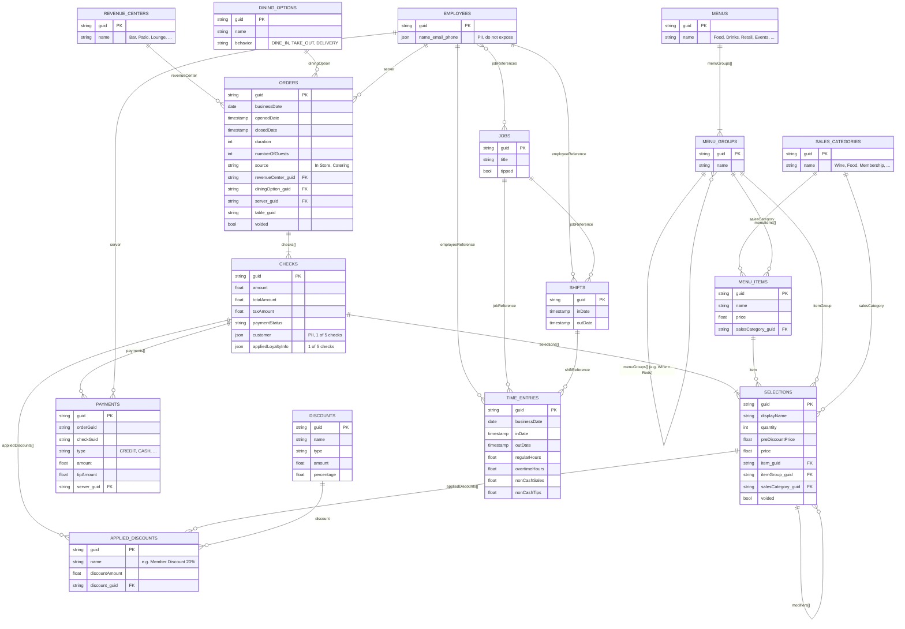

# Toast data model

Built from `toast_samples/*.json` (sample of 5 orders).

## Diagram

## Arrow types

Each end of a line shows how many rows can sit on that side.

| Symbol | Meaning |
|---|---|
| `\|\|` | exactly one |
| `o\|` | zero or one |
| `\|{` | one or more |
| `o{` | zero or more |

Examples:
- `ORDERS ||--|{ CHECKS`: one order has one or more checks; each check belongs to exactly one order.
- `REVENUE_CENTERS ||--o{ ORDERS`: one revenue center has zero or more orders; each order points to one revenue center.
- `EMPLOYEES }o--o{ JOBS`: many-to-many; an employee can hold several jobs, and a job can belong to several employees.

The label on a line is the JSON field that links the tables. Labels ending in `[]` are arrays nested inside the parent JSON. Other labels are GUID references to a lookup table.

## Notes from the sample
- Orders → checks → selections → modifiers are nested arrays inside one order JSON; dbt will flatten each level into its own staging model.
- Modifiers have the same structure as selections.
- Members: `Member Discount 20%` appears on selections' `appliedDiscounts`. Check-level `appliedDiscounts` were empty in this sample.
- Tips live on payments, not checks.
- Menu groups nest (Wine > Whites/Rosé/Reds/...).

